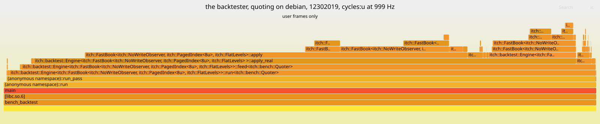

# Flamegraph: the backtester, quoting on debian, 12302019

Generated by `scripts/flame_report.py` from sampled stacks that are not committed. Do not edit by hand.

Host: **debian**. Numbers from the two hosts are never mixed.



[flamegraph_backtest-quoting_debian_12302019.svg](flamegraph_backtest-quoting_debian_12302019.svg), interactive in a browser: hover for a frame's samples, click to zoom.

## Header

- host: debian
- cpu: AMD Ryzen Embedded V1605B with Radeon Vega Gfx
- kernel: Linux 6.12.115+deb13.1-amd64
- compiler: Clang 23.1.4 (https://github.com/llvm/llvm-project 7a941dfb2877a0b8cf30323fefa85ad019e0b0f5)
- flags: -fno-omit-frame-pointer -mno-omit-leaf-frame-pointer -g -O3 -DNDEBUG -std=c++23
- commit: 5a16936a14e8
- pinning: pinned to core 4: pthread_setaffinity_np returned 0, read back [4]
- governor: performance
- frequency: 3593026 kHz
- turbo: on
- build: frame pointers
- workload: the backtester, quoting
- event: cycles:u at 999 Hz
- samples: 119,933
- stacks: 113
- prediction: P-0018
- run_id: P-0018-20261105T081446Z
- frame_pointer_ratio: 0.9755
- summary: 119,933 samples, cycles:u at 999 Hz, the hottest frame `itch::FastBook<…>::apply` at 38.53% self; the frame-pointer build at 0.9755 of the normal build's throughput, both measured on `paged-flat`

## What it shows

The backtester on T-BT-1's workload, `bench_backtest --workload quoting`, the whole day
through the exchange-side book (`paged-flat`) with the quoting strategy, in one process
pinned to core 4. Self is a frame's samples at the top of the stack; total adds every
frame it called.

- **The book is the backtester's cost.** `Engine::apply_real` holds 91.62% of the samples
  in total, and the exchange book's `FastBook::apply` under it 78.73%, with the same frames
  below it as the plain replay. The table's `FastBook`, `PagedIndex` and `FlatLevels` rows
  hold the samples of both of the engine's books, the exchange book and the strategy's
  view of it, which are one instantiation: `apply` at 81.22% total is 78.73% under
  `apply_real`, 2.07% under `dispatch`, which applies each delayed message to the view
  book, and 0.41% directly under `feed`, with no frame between to say which book it is.
  Its self share is 38.53%, and below it `write_level` holds 16.13% self, `rest_order`
  13.20% and `replace_order` 6.11%.
- **The strategy is small.** The quoter's own frames (`Quoter::on_market` and `quote`)
  hold 0.23% of the samples self and 0.25% in total. The engine's `dispatch`, which hands
  each delayed message to the view book and then to the quoter, holds 2.64% in total,
  2.07% of it the view book's `apply`: most messages are on symbols the strategy does not
  trade. Under `Engine::run`, everything that is not `apply_real` is 7.31% of the samples,
  in total. Counting the engine's frames outside `run` too it is 7.79%: the constructor,
  0.17%, most of it in `FastBook`'s constructor, and 0.31% in `feed` on stacks where `run`
  does not appear between it and `run_pass`.
- **The same three loads.** The annotate excerpt below is `FastBook::apply`, the symbol
  both books share, 96.94% of whose samples are under `apply_real`. Its hottest
  instructions are the ones the replay's graph shows, at nearly the same shares: the
  backtester inherits the book's memory behaviour unchanged.

## Hottest frames

The 15 frames with the most samples at the top of the stack. Self is the share of samples in the frame itself; total adds every frame it called.

| Frame | Self | Total |
|---|---|---|
| `itch::FastBook<…>::apply` | 38.53% | 81.22% |
| `itch::FastBook<…>::write_level` | 16.13% | 18.60% |
| `itch::FastBook<…>::rest_order` | 13.20% | 23.22% |
| `itch::backtest::Engine<…>::apply_real` | 8.72% | 91.62% |
| `itch::FastBook<…>::replace_order` | 6.11% | 14.62% |
| `itch::PagedIndex<…>::erase` | 2.86% | 2.86% |
| `itch::FlatLevels::open<…>` | 2.48% | 2.48% |
| `itch::FastBook<…>::deduct` | 2.13% | 2.70% |
| `itch::FastBook<…>::remove_order` | 2.00% | 10.38% |
| `itch::backtest::Engine<…>::feed<…>` | 1.91% | 97.21% |
| `itch::backtest::Engine<…>::run<…>` | 1.75% | 98.93% |
| `itch::PagedIndex<…>::insert` | 0.99% | 0.99% |
| `itch::backtest::Engine<…>::next_event` | 0.72% | 0.72% |
| `itch::backtest::Engine<…>::real_replace` | 0.61% | 14.84% |
| `(anonymous namespace)::run` | 0.47% | 99.99% |

## perf annotate, the hottest function

`perf annotate --stdio` on `FastBook<NoWriteObserver, PagedIndex<8>, FlatLevels>::apply`, the lines with the most samples and the code around them. The percentages are of that symbol's samples.

```
         : 3     Disassembly of section .text:
         :
         : 5     00000000000221c0 <itch::FastBook<itch::NoWriteObserver, itch::PagedIndex<8u>, itch::FlatLevels>::apply(std::__1::span<std::byte const, 18446744073709551615ul>)>:
    0.12 :   221c0:  push   %rbp
    0.88 :   221c1:  mov    %rsp,%rbp
    0.01 :   221c4:  push   %r14
    0.12 :   221c6:  push   %rbx
    0.13 :   221c7:  sub    $0x30,%rsp
    0.07 :   221cb:  mov    $0x1,%al
        ...
    0.01 :   22383:  mov    0x20(%rdi),%rax
    0.03 :   22387:  mov    %r9,%rcx
    0.04 :   2238a:  shr    $0x8,%rcx
    0.07 :   2238e:  mov    (%rax,%rcx,4),%ecx
    5.12 :   22391:  mov    $0xffffffff,%eax
    0.01 :   22396:  cmp    %rax,%rcx
    0.00 :   22399:  je     224d7 <itch::FastBook<itch::NoWriteObserver, itch::PagedIndex<8u>, itch::FlatLevels>::apply(std::__1::span<std::byte const, 18446744073709551615ul>)+0x317>
    0.00 :   2239f:  shl    $0xa,%rcx
    0.00 :   223a3:  add    0x38(%rdi),%rcx
    0.04 :   223a7:  movzbl %r9b,%esi
    0.00 :   223ab:  mov    (%rcx,%rsi,4),%ebx
   28.55 :   223ae:  mov    %ebx,%esi
    0.01 :   223b0:  cmp    %rax,%rbx
    0.01 :   223b3:  je     224d7 <itch::FastBook<itch::NoWriteObserver, itch::PagedIndex<8u>, itch::FlatLevels>::apply(std::__1::span<std::byte const, 18446744073709551615ul>)+0x317>
    0.00 :   223b9:  rol    $0x8,%dx
    0.00 :   223bd:  lea    (%rbx,%rbx,2),%rax
    0.34 :   223c1:  mov    0xc(%r8,%rax,8),%ecx
   26.58 :   223c6:  mov    0xd0(%rdi),%r8
    0.02 :   223cd:  shl    $0x5,%rcx
    0.00 :   223d1:  mov    $0x3,%al
    0.30 :   223d3:  cmp    %dx,0x18(%r8,%rcx,1)
   23.25 :   223d9:  jne    224ce <itch::FastBook<itch::NoWriteObserver, itch::PagedIndex<8u>, itch::FlatLevels>::apply(std::__1::span<std::byte const, 18446744073709551615ul>)+0x30e>
    0.02 :   223df:  call   23ed0 <itch::FastBook<itch::NoWriteObserver, itch::PagedIndex<8u>, itch::FlatLevels>::remove_order(unsigned int)>
    0.09 :   223e4:  xor    %eax,%eax
    0.03 :   223e6:  jmp    224ce <itch::FastBook<itch::NoWriteObserver, itch::PagedIndex<8u>, itch::FlatLevels>::apply(std::__1::span<std::byte const, 18446744073709551615ul>)+0x30e>
    0.25 :   223eb:  movzwl 0x1(%rsi),%r9d
        ...
    0.03 :   2243a:  add    0x38(%rdi),%rcx
    0.04 :   2243e:  movzbl %dl,%ebx
    0.00 :   22441:  mov    $0x5,%al
    0.00 :   22443:  cmpl   $0xffffffff,(%rcx,%rbx,4)
    8.37 :   22447:  jne    224ce <itch::FastBook<itch::NoWriteObserver, itch::PagedIndex<8u>, itch::FlatLevels>::apply(std::__1::span<std::byte const, 18446744073709551615ul>)+0x30e>
    0.08 :   2244d:  cmpq   $0x0,0xb0(%rdi)
    0.08 :   22455:  je     224a8 <itch::FastBook<itch::NoWriteObserver, itch::PagedIndex<8u>, itch::FlatLevels>::apply(std::__1::span<std::byte const, 18446744073709551615ul>)+0x2e8>
    0.00 :   22457:  movabs $0x9e3779b97f4a7c15,%rax
    0.00 :   22461:  imul   %rdx,%rax
```

## The frame-pointer build

The graph is taken on a build with `-fno-omit-frame-pointer -mno-omit-leaf-frame-pointer`, which keeps a frame pointer in every function so that `perf` can walk the stack. Both builds ran `paged-flat` mapped, top of book not tracked, throughput only, in the same sitting through `scripts/bench_driver.py`. The frame-pointer build ran at 0.9755 times the normal build's median throughput, -2.45%.

| Build | Flags | Median messages/s | Min | Max | CV | Commit | File |
|---|---|---|---|---|---|---|---|
| normal | `-O3 -DNDEBUG -std=c++23` | 5,505,524 | 5,490,985 | 5,509,468 | 0.18% | `5a16936a14e8` | [results/bench_book_paged-flat_mapped_normalbuild_debian_12302019.md](bench_book_paged-flat_mapped_normalbuild_debian_12302019.md) |
| frame pointers | `-fno-omit-frame-pointer -mno-omit-leaf-frame-pointer -g -O3 -DNDEBUG -std=c++23` | 5,370,409 | 5,344,519 | 5,380,451 | 0.35% | `5a16936a14e8` | [results/bench_book_paged-flat_mapped_fpbuild_debian_12302019.md](bench_book_paged-flat_mapped_fpbuild_debian_12302019.md) |

## What it cannot show

- **User space only.** At `perf_event_paranoid=2` `cycles:k` is refused, so no kernel frame
  appears and none can: time in page faults, system calls and interrupts shows only as the
  gap it leaves. No system setting was changed to get them.
- **Inlining hides the detail.** The book's operations are inlined into the pass that calls
  them, so a wide frame is several functions, and Zen 1 has no LBR to recover the path
  (`perf record --call-graph lbr` is refused here). The `perf annotate` excerpt below is what
  says where inside the hottest function the samples land.
- **Skid.** `cycles:u` on Zen 1 is not precise: `cycles:pp` needs IBS, which refuses user-only
  sampling. A sample lands on an instruction near the one that stalled, often the next.
- **The frame-pointer build is not the build measured elsewhere.** Its throughput against the
  normal build is below. Stacks are walked by frame pointer; a frame without one (libc's
  hand-written routines) is attributed to its caller.
- **One run.** A flamegraph is a sample of one process, not a measurement with a spread.

## Command

```
measure.sh taskset -c 4 perf record -g --user-callchains -e cycles:u -F 999 -o backtest-quoting.data -- build-fp/bench/bench_backtest --input data/12302019.NASDAQ_ITCH50 --workload quoting --date 20191230 --core 4; then perf script -i backtest-quoting.data | flame_report.py fold-perf; flamegraph.pl --hash (FlameGraph 41fee1f); perf annotate -i backtest-quoting.data --stdio --no-source, the block of FastBook<NoWriteObserver, PagedIndex<8>, FlatLevels>::apply
```
