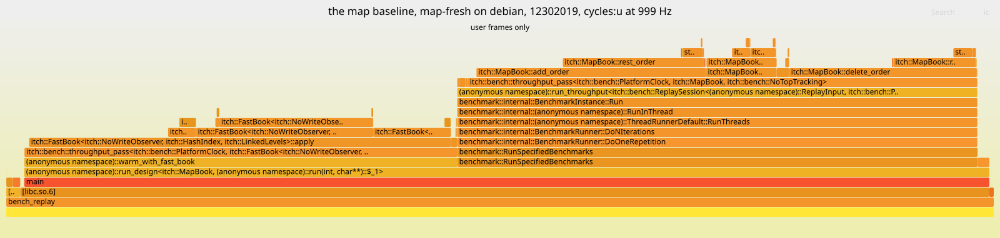

# Flamegraph: the map baseline, map-fresh on debian, 12302019

Generated by `scripts/flame_report.py` from sampled stacks that are not committed. Do not edit by hand.

Host: **debian**. Numbers from the two hosts are never mixed.



[flamegraph_map-fresh_debian_12302019.svg](flamegraph_map-fresh_debian_12302019.svg), interactive in a browser: hover for a frame's samples, click to zoom.

## Header

- host: debian
- cpu: AMD Ryzen Embedded V1605B with Radeon Vega Gfx
- kernel: Linux 6.12.115+deb13.1-amd64
- compiler: Clang 23.1.4 (https://github.com/llvm/llvm-project 7a941dfb2877a0b8cf30323fefa85ad019e0b0f5)
- flags: -fno-omit-frame-pointer -mno-omit-leaf-frame-pointer -g -O3 -DNDEBUG -std=c++23
- commit: 5a16936a14e8
- pinning: pinned to core 4: pthread_setaffinity_np returned 0, read back [4]
- governor: performance
- frequency: 3593025 kHz
- turbo: on
- build: frame pointers
- workload: the map baseline, map-fresh
- event: cycles:u at 999 Hz
- samples: 243,786
- stacks: 124
- prediction: P-0018
- run_id: P-0018-20261105T081041Z
- frame_pointer_ratio: 0.9755
- summary: 243,786 samples, cycles:u at 999 Hz, the hottest frame `itch::FastBook<…>::rest_order` at 22.63% self; the frame-pointer build at 0.9755 of the normal build's throughput, both measured on `paged-flat`

## What it shows

The map baseline, `map-fresh`, the day mapped, as `bench_replay --passes throughput` runs
it. Its warm-up replays the day through the `hash-linked` fast book
(`warm_with_fast_book`), so the graph has two towers that are different books.

- **The warm-up is the left tower, 43.85% of the samples.** `FastBook<HashIndex,
  LinkedLevels>::rest_order` is the hottest symbol in the whole process, 22.63% self, and
  it belongs to the warm-up, not to the map book. It is left in the graph because it is
  what the process ran.
- **The map book's timed replay is the other tower, 52.66%,** under Google Benchmark's
  `run_throughput`. Its frames are `MapBook::rest_order` (14.28% self), `delete_order`
  (10.64%), `add_order` (8.93%), `remove_order` (7.70%) and `replace_order` (2.59%), with
  the `std::unordered_map` order table's own `remove` and `emplace` at 2.45% and 2.13%.
- **The tree walk.** The annotate excerpt below is `MapBook::rest_order`, the map book's
  hottest function, not the process's: 81.34% of its samples sit on one branch, right
  after a compare that loads a `std::map` node's price. That is the walk down the
  red-black tree of price levels, one dependent node load a level, which is where the map
  book's extra DRAM demand fills come from (5.38 a book message against `paged-flat`'s
  2.00, results/counters_by_type_map-fresh_debian_12302019.md).
- **Allocation is small.** `malloc` and `free` together hold under 2% of the samples
  on their own frames: the map book allocates a node per new level and order, but the
  time goes on finding things, not on making them.

## Hottest frames

The 15 frames with the most samples at the top of the stack. Self is the share of samples in the frame itself; total adds every frame it called.

| Frame | Self | Total |
|---|---|---|
| `itch::FastBook<…>::rest_order` | 22.63% | 23.43% |
| `itch::MapBook::rest_order` | 14.28% | 16.92% |
| `itch::FastBook<…>::apply` | 14.08% | 42.73% |
| `itch::MapBook::delete_order` | 10.64% | 19.24% |
| `itch::MapBook::add_order` | 8.93% | 23.43% |
| `itch::MapBook::remove_order` | 7.70% | 10.61% |
| `itch::FastBook<…>::write_level` | 2.90% | 2.90% |
| `itch::MapBook::replace_order` | 2.59% | 7.10% |
| `std::__1::__hash_table<…>::remove[abi:nqe230104]` | 2.45% | 2.45% |
| `std::__1::__hash_table<…>::__emplace_unique[abi:nqe230104]<…>(unsigned long&, itch::MapBook::Order&&)::{lambda(unsigned long const&, unsigned long&, itch::MapBook::Order&&)#1}::operator()[abi:nqe230104]` | 2.13% | 2.28% |
| `itch::FastBook<…>::replace_order` | 1.97% | 17.95% |
| `itch::FastBook<…>::remove_order` | 1.34% | 3.36% |
| `itch::bench::count_mix` | 1.18% | 1.18% |
| `[libc.so.6]` | 1.07% | 98.79% |
| `cfree` | 0.94% | 0.94% |

Each row is one function, so the instantiations of a template, which the table prints alike, are ranked apart:

- `itch::bench::throughput_pass<…>` has 2 instantiations, ranked apart at 0.86% and 0.47% self, neither in the list; merged, at 1.33% self and 95.40% total, it would rank 13th and `cfree` would drop out of the list.

## perf annotate, the hottest function

`perf annotate --stdio` on `MapBook::rest_order`, the lines with the most samples and the code around them. The percentages are of that symbol's samples.

```
    0.01 :   47e0c:  or     %edx,%esi
    0.01 :   47e0e:  mov    (%rdi),%rax
    0.02 :   47e11:  lea    (%rsi,%rsi,2),%rcx
    0.00 :   47e15:  mov    0x8(%rax,%rcx,8),%rsi
    2.92 :   47e1a:  test   %rsi,%rsi
    0.00 :   47e1d:  je     47e5a <itch::MapBook::rest_order(unsigned short, itch::Side, unsigned int, unsigned long, unsigned int)+0x7a>
    0.00 :   47e1f:  xor    %edx,%edx
    0.05 :   47e21:  jmp    47e3c <itch::MapBook::rest_order(unsigned short, itch::Side, unsigned int, unsigned long, unsigned int)+0x5c>
    0.00 :   47e23:  data16 data16 data16 cs nopw 0x0(%rax,%rax,1)
    0.02 :   47e30:  mov    0x0(%r13),%rsi
    3.00 :   47e34:  mov    %r13,%r12
    0.00 :   47e37:  test   %rsi,%rsi
    0.04 :   47e3a:  je     47e65 <itch::MapBook::rest_order(unsigned short, itch::Side, unsigned int, unsigned long, unsigned int)+0x85>
    0.00 :   47e3c:  mov    %rsi,%r13
    0.10 :   47e3f:  cmp    0x20(%rsi),%r14d
   81.34 :   47e43:  jb     47e30 <itch::MapBook::rest_order(unsigned short, itch::Side, unsigned int, unsigned long, unsigned int)+0x50>
    0.03 :   47e45:  je     47ece <itch::MapBook::rest_order(unsigned short, itch::Side, unsigned int, unsigned long, unsigned int)+0xee>
    0.68 :   47e4b:  mov    0x8(%r13),%rsi
    2.18 :   47e4f:  test   %rsi,%rsi
    0.12 :   47e52:  jne    47e3c <itch::MapBook::rest_order(unsigned short, itch::Side, unsigned int, unsigned long, unsigned int)+0x5c>
    0.00 :   47e54:  lea    0x8(%r13),%r12
    0.19 :   47e58:  jmp    47e65 <itch::MapBook::rest_order(unsigned short, itch::Side, unsigned int, unsigned long, unsigned int)+0x85>
    0.00 :   47e5a:  lea    (%rax,%rcx,8),%r12
        ...
    0.03 :   47e9f:  mov    %rax,0x10(%r13)
    0.01 :   47ea3:  mov    %r13,(%r12)
    0.01 :   47ea7:  mov    (%r15),%rax
    0.12 :   47eaa:  mov    (%rax),%rax
    3.08 :   47ead:  test   %rax,%rax
    0.01 :   47eb0:  je     47eb5 <itch::MapBook::rest_order(unsigned short, itch::Side, unsigned int, unsigned long, unsigned int)+0xd5>
    0.00 :   47eb2:  mov    %rax,(%r15)
    0.01 :   47eb5:  mov    0x8(%r15),%rdi
    0.01 :   47eb9:  mov    %r13,%rsi
        ...
    0.00 :   47eee:  mov    %r14,0x8(%rax)
    0.03 :   47ef2:  mov    0x28(%r13),%rcx
    0.00 :   47ef6:  mov    %rcx,(%rax)
    0.02 :   47ef9:  mov    %rax,0x8(%rcx)
    2.36 :   47efd:  mov    %rax,0x28(%r13)
    0.01 :   47f01:  movdqu 0x38(%r13),%xmm0
    0.61 :   47f07:  movd   %edx,%xmm1
    0.02 :   47f0b:  movdqa 0x4a24d(%rip),%xmm2        # 92160 <_IO_stdin_used+0x160>
    0.03 :   47f13:  punpcklqdq %xmm1,%xmm2
```

## The frame-pointer build

The graph is taken on a build with `-fno-omit-frame-pointer -mno-omit-leaf-frame-pointer`, which keeps a frame pointer in every function so that `perf` can walk the stack. Both builds ran `paged-flat` mapped, top of book not tracked, throughput only, in the same sitting through `scripts/bench_driver.py`. The frame-pointer build ran at 0.9755 times the normal build's median throughput, -2.45%.

| Build | Flags | Median messages/s | Min | Max | CV | Commit | File |
|---|---|---|---|---|---|---|---|
| normal | `-O3 -DNDEBUG -std=c++23` | 5,505,524 | 5,490,985 | 5,509,468 | 0.18% | `5a16936a14e8` | [results/bench_book_paged-flat_mapped_normalbuild_debian_12302019.md](bench_book_paged-flat_mapped_normalbuild_debian_12302019.md) |
| frame pointers | `-fno-omit-frame-pointer -mno-omit-leaf-frame-pointer -g -O3 -DNDEBUG -std=c++23` | 5,370,409 | 5,344,519 | 5,380,451 | 0.35% | `5a16936a14e8` | [results/bench_book_paged-flat_mapped_fpbuild_debian_12302019.md](bench_book_paged-flat_mapped_fpbuild_debian_12302019.md) |

## What it cannot show

- **User space only.** At `perf_event_paranoid=2` `cycles:k` is refused, so no kernel frame
  appears and none can: time in page faults, system calls and interrupts shows only as the
  gap it leaves. No system setting was changed to get them.
- **Inlining hides the detail.** The book's operations are inlined into the pass that calls
  them, so a wide frame is several functions, and Zen 1 has no LBR to recover the path
  (`perf record --call-graph lbr` is refused here). The `perf annotate` excerpt below is what
  says where inside the hottest function the samples land.
- **Skid.** `cycles:u` on Zen 1 is not precise: `cycles:pp` needs IBS, which refuses user-only
  sampling. A sample lands on an instruction near the one that stalled, often the next.
- **The frame-pointer build is not the build measured elsewhere.** Its throughput against the
  normal build is below. Stacks are walked by frame pointer; a frame without one (libc's
  hand-written routines) is attributed to its caller.
- **One run.** A flamegraph is a sample of one process, not a measurement with a spread.

## Command

```
measure.sh taskset -c 4 perf record -g --user-callchains -e cycles:u -F 999 -o map-fresh.data -- build-fp/bench/bench_replay --input data/12302019.NASDAQ_ITCH50 --design map-fresh --input-mode mapped --passes throughput --core 4; then perf script -i map-fresh.data | flame_report.py fold-perf; flamegraph.pl --hash (FlameGraph 41fee1f); perf annotate -i map-fresh.data --stdio --no-source, the block of MapBook::rest_order
```
