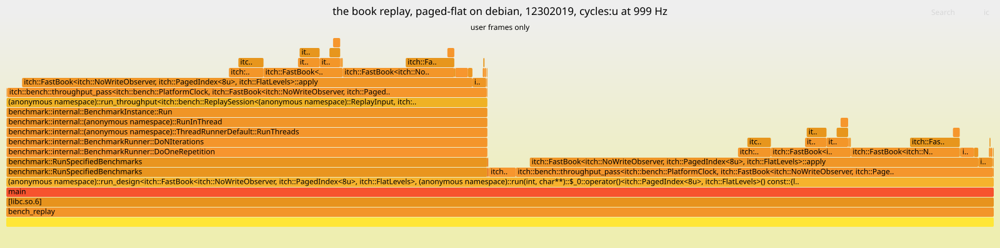

# Flamegraph: the book replay, paged-flat on debian, 12302019

Generated by `scripts/flame_report.py` from sampled stacks that are not committed. Do not edit by hand.

Host: **debian**. Numbers from the two hosts are never mixed.



[flamegraph_paged-flat_debian_12302019.svg](flamegraph_paged-flat_debian_12302019.svg), interactive in a browser: hover for a frame's samples, click to zoom.

## Header

- host: debian
- cpu: AMD Ryzen Embedded V1605B with Radeon Vega Gfx
- kernel: Linux 6.12.115+deb13.1-amd64
- compiler: Clang 23.1.4 (https://github.com/llvm/llvm-project 7a941dfb2877a0b8cf30323fefa85ad019e0b0f5)
- flags: -fno-omit-frame-pointer -mno-omit-leaf-frame-pointer -g -O3 -DNDEBUG -std=c++23
- commit: 5a16936a14e8
- pinning: pinned to core 4: pthread_setaffinity_np returned 0, read back [4]
- governor: performance
- frequency: 3593015 kHz
- turbo: on
- build: frame pointers
- workload: the book replay, paged-flat
- event: cycles:u at 999 Hz
- samples: 105,077
- stacks: 83
- prediction: P-0018
- run_id: P-0018-20261105T080854Z
- frame_pointer_ratio: 0.9755
- summary: 105,077 samples, cycles:u at 999 Hz, the hottest frame `itch::FastBook<…>::apply` at 42.14% self; the frame-pointer build at 0.9755 of the normal build's throughput

## What it shows

The book replay on `paged-flat`, the day mapped, as `bench_replay --passes throughput` runs
it: the warm-up replay, the timed replay under Google Benchmark, and the warm-up's walk of
the frames (`count_mix`), in one process pinned to core 4.

- **Two towers of the same pass.** `throughput_pass` holds 96.86% of the samples, about
  half under `run_design` directly (the warm-up) and half under Google Benchmark's
  `run_throughput` (the timed replay). Each is the frame walk and the parse inlined into
  the pass, calling the book.
- **`FastBook::apply` is the widest frame, 42.14% self.** The order index lookup and the
  message dispatch are inlined into it. The annotate excerpt below shows where: three
  instructions hold about four fifths of its samples, each right after a load that
  depends on the one before (the page index's slot, then the order record, then its
  level). On Zen 1 a `cycles:u` sample lands on the instruction after the one that
  stalled, so these are the three dependent loads of an order lookup, the same loads the
  counters charge about two DRAM demand fills a book message to.
- **The level writes are next.** `write_level`, 18.73% self, reached from `rest_order`
  (adds and replaces) and `remove_order` (cancels, deletes and executions); `rest_order`
  14.43% self and `replace_order` 7.00% self. The level map's `FlatLevels::open` and the
  index's `PagedIndex::erase` and `insert`, out of line, are 7.25% together.
- **Nothing outside the pass.** No allocation, no system call, no frame from the timer
  above 0.1%: the replay is the book and nothing else, as the Mac's profile also shows.

## Hottest frames

The 15 frames with the most samples at the top of the stack. Self is the share of samples in the frame itself; total adds every frame it called.

| Frame | Self | Total |
|---|---|---|
| `itch::FastBook<…>::apply` | 42.14% | 91.12% |
| `itch::FastBook<…>::write_level` | 18.73% | 21.61% |
| `itch::FastBook<…>::rest_order` | 14.43% | 26.63% |
| `itch::FastBook<…>::replace_order` | 7.00% | 16.16% |
| `itch::PagedIndex<…>::erase` | 3.25% | 3.25% |
| `itch::bench::throughput_pass<…>` | 2.91% | 96.86% |
| `itch::FlatLevels::open<…>` | 2.88% | 2.88% |
| `itch::bench::count_mix` | 2.73% | 2.73% |
| `itch::FastBook<…>::remove_order` | 2.39% | 11.57% |
| `itch::FastBook<…>::deduct` | 2.13% | 2.83% |
| `itch::PagedIndex<…>::insert` | 1.12% | 1.12% |
| `[libc.so.6]` | 0.14% | 99.99% |
| `__vdso_clock_gettime` | 0.09% | 0.09% |
| `itch::bench::ReplaySession<…>::input_resident` | 0.02% | 0.02% |
| `(anonymous namespace)::run_design<…>` | 0.02% | 99.99% |

## perf annotate, the hottest function

`perf annotate --stdio` on `FastBook<NoWriteObserver, PagedIndex<8>, FlatLevels>::apply`, the lines with the most samples and the code around them. The percentages are of that symbol's samples.

```
    0.03 :   675e3:  mov    0x20(%rdi),%rax
    0.07 :   675e7:  mov    %r9,%rcx
    0.01 :   675ea:  shr    $0x8,%rcx
    0.01 :   675ee:  mov    (%rax,%rcx,4),%ecx
    4.65 :   675f1:  mov    $0xffffffff,%eax
    0.00 :   675f6:  cmp    %rax,%rcx
    0.01 :   675f9:  je     67737 <itch::FastBook<itch::NoWriteObserver, itch::PagedIndex<8u>, itch::FlatLevels>::apply(std::__1::span<std::byte const, 18446744073709551615ul>)+0x317>
    0.00 :   675ff:  shl    $0xa,%rcx
    0.00 :   67603:  add    0x38(%rdi),%rcx
    0.04 :   67607:  movzbl %r9b,%esi
    0.00 :   6760b:  mov    (%rcx,%rsi,4),%ebx
   28.05 :   6760e:  mov    %ebx,%esi
    0.02 :   67610:  cmp    %rax,%rbx
    0.01 :   67613:  je     67737 <itch::FastBook<itch::NoWriteObserver, itch::PagedIndex<8u>, itch::FlatLevels>::apply(std::__1::span<std::byte const, 18446744073709551615ul>)+0x317>
    0.00 :   67619:  rol    $0x8,%dx
    0.00 :   6761d:  lea    (%rbx,%rbx,2),%rax
    0.34 :   67621:  mov    0xc(%r8,%rax,8),%ecx
   27.14 :   67626:  mov    0xd0(%rdi),%r8
    0.04 :   6762d:  shl    $0x5,%rcx
    0.00 :   67631:  mov    $0x3,%al
    0.00 :   67633:  cmp    %dx,0x18(%r8,%rcx,1)
   23.86 :   67639:  jne    6772e <itch::FastBook<itch::NoWriteObserver, itch::PagedIndex<8u>, itch::FlatLevels>::apply(std::__1::span<std::byte const, 18446744073709551615ul>)+0x30e>
    0.02 :   6763f:  call   68290 <itch::FastBook<itch::NoWriteObserver, itch::PagedIndex<8u>, itch::FlatLevels>::remove_order(unsigned int)>
    0.09 :   67644:  xor    %eax,%eax
    0.02 :   67646:  jmp    6772e <itch::FastBook<itch::NoWriteObserver, itch::PagedIndex<8u>, itch::FlatLevels>::apply(std::__1::span<std::byte const, 18446744073709551615ul>)+0x30e>
    0.02 :   6764b:  movzwl 0x1(%rsi),%r9d
    1.23 :   67650:  mov    0xb(%rsi),%rdx
    0.14 :   67654:  movzbl 0x13(%rsi),%r10d
    0.07 :   67659:  mov    0x14(%rsi),%r8d
    0.09 :   6765d:  mov    0x20(%rsi),%esi
    0.17 :   67660:  cmp    $0x53,%r10d
        ...
    0.00 :   6769a:  add    0x38(%rdi),%rcx
    0.03 :   6769e:  movzbl %dl,%ebx
    0.01 :   676a1:  mov    $0x5,%al
    0.01 :   676a3:  cmpl   $0xffffffff,(%rcx,%rbx,4)
    8.02 :   676a7:  jne    6772e <itch::FastBook<itch::NoWriteObserver, itch::PagedIndex<8u>, itch::FlatLevels>::apply(std::__1::span<std::byte const, 18446744073709551615ul>)+0x30e>
    0.06 :   676ad:  cmpq   $0x0,0xb0(%rdi)
    0.07 :   676b5:  je     67708 <itch::FastBook<itch::NoWriteObserver, itch::PagedIndex<8u>, itch::FlatLevels>::apply(std::__1::span<std::byte const, 18446744073709551615ul>)+0x2e8>
    0.00 :   676b7:  movabs $0x9e3779b97f4a7c15,%rax
    0.00 :   676c1:  imul   %rdx,%rax
```

## The frame-pointer build

The graph is taken on a build with `-fno-omit-frame-pointer -mno-omit-leaf-frame-pointer`, which keeps a frame pointer in every function so that `perf` can walk the stack. Both builds ran `paged-flat` mapped, top of book not tracked, throughput only, in the same sitting through `scripts/bench_driver.py`. The frame-pointer build ran at 0.9755 times the normal build's median throughput, -2.45%.

| Build | Flags | Median messages/s | Min | Max | CV | Commit | File |
|---|---|---|---|---|---|---|---|
| normal | `-O3 -DNDEBUG -std=c++23` | 5,505,524 | 5,490,985 | 5,509,468 | 0.18% | `5a16936a14e8` | [results/bench_book_paged-flat_mapped_normalbuild_debian_12302019.md](bench_book_paged-flat_mapped_normalbuild_debian_12302019.md) |
| frame pointers | `-fno-omit-frame-pointer -mno-omit-leaf-frame-pointer -g -O3 -DNDEBUG -std=c++23` | 5,370,409 | 5,344,519 | 5,380,451 | 0.35% | `5a16936a14e8` | [results/bench_book_paged-flat_mapped_fpbuild_debian_12302019.md](bench_book_paged-flat_mapped_fpbuild_debian_12302019.md) |

## What it cannot show

- **User space only.** At `perf_event_paranoid=2` `cycles:k` is refused, so no kernel frame
  appears and none can: time in page faults, system calls and interrupts shows only as the
  gap it leaves. No system setting was changed to get them.
- **Inlining hides the detail.** The book's operations are inlined into the pass that calls
  them, so a wide frame is several functions, and Zen 1 has no LBR to recover the path
  (`perf record --call-graph lbr` is refused here). The `perf annotate` excerpt below is what
  says where inside the hottest function the samples land.
- **Skid.** `cycles:u` on Zen 1 is not precise: `cycles:pp` needs IBS, which refuses user-only
  sampling. A sample lands on an instruction near the one that stalled, often the next.
- **The frame-pointer build is not the build measured elsewhere.** Its throughput against the
  normal build is below. Stacks are walked by frame pointer; a frame without one (libc's
  hand-written routines) is attributed to its caller.
- **One run.** A flamegraph is a sample of one process, not a measurement with a spread.

## Command

```
measure.sh taskset -c 4 perf record -g --user-callchains -e cycles:u -F 999 -o paged-flat.data -- build-fp/bench/bench_replay --input data/12302019.NASDAQ_ITCH50 --design paged-flat --input-mode mapped --passes throughput --core 4; then perf script -i paged-flat.data | flame_report.py fold-perf; flamegraph.pl --hash (FlameGraph 41fee1f); perf annotate -i paged-flat.data --stdio --no-source, the block of FastBook<NoWriteObserver, PagedIndex<8>, FlatLevels>::apply
```
