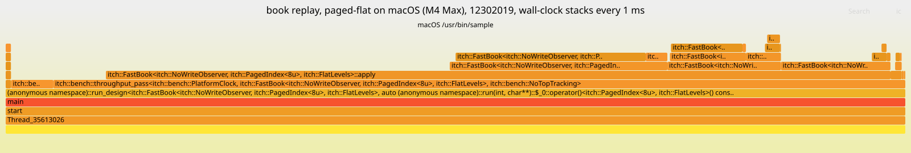

# Flamegraph: book replay, paged-flat on macOS (M4 Max), 12302019

Generated by `scripts/flame_report.py` from sampled stacks that are not committed. Do not edit by hand.

Host: **macOS (M4 Max)**. A macOS profile: it does not replace the `perf` data from `debian`.



[profile_paged-flat_mac_12302019.svg](profile_paged-flat_mac_12302019.svg), interactive in a browser: hover for a frame's samples, click to zoom.

## Header

- host: macOS (M4 Max)
- cpu: Apple M4 Max
- kernel: Darwin 27.2.0
- compiler: Clang 23.1.4 (https://github.com/llvm/llvm-project 7a941dfb2877a0b8cf30323fefa85ad019e0b0f5)
- flags: -O3 -DNDEBUG -std=c++23
- commit: 5a16936a14e8 (clean)
- pinning: not pinned: thread_policy_set returned code 46, pthread_set_qos_class_self_np(QOS_CLASS_USER_INTERACTIVE) returned 0
- governor: unavailable: macOS has no cpufreq governor
- frequency: unavailable: macOS exposes no core frequency on Apple silicon
- turbo: unavailable: macOS exposes no boost control
- build: normal
- workload: book replay, paged-flat
- event: wall-clock stacks every 1 ms
- samples: 19,118
- stacks: 30
- prediction: none: the macOS profile was run before any prediction for it; no target rests on it
- summary: 19,118 samples, wall-clock stacks every 1 ms, the hottest frame `itch::FastBook<…>::apply` at 38.24% self

## What it shows

The book replay on `paged-flat`, the day mapped, warm-up and one throughput pass, sampled for
25 seconds from one second after the process started. That window covers the end of the
warm-up count (`count_mix`, about 5% of the samples) and then the throughput pass.

- **The pass is the book.** `throughput_pass` and what it calls hold about 95% of the
  samples. Its own frame, the parse loop and the frame walk inlined into it, holds about 6%.
- **`FastBook::apply` and the level writes.** `apply` itself, with the order index lookup
  inlined, is the widest self frame; `write_level`, reached from `remove_order` (cancels,
  deletes, executions) and from `rest_order` (adds, replaces), is next. Together they are
  about two thirds of the samples: the book's time goes on finding the order and touching
  its price level, which is where the Linux counters put the DRAM fills.
- **The index and the level map are small.** `PagedIndex::erase` and `insert` and
  `FlatLevels::open` are a few percent between them. Most of the index's work is inlined
  into `apply`, so these frames are its out-of-line slow paths only.
- **Nothing else.** No allocation, no system call frame, no I/O: the day is mapped and
  resident, and the pass allocates nothing.

## Hottest frames

The 13 frames with the most samples at the top of the stack. Self is the share of samples in the frame itself; total adds every frame it called.

| Frame | Self | Total |
|---|---|---|
| `itch::FastBook<…>::apply` | 38.24% | 87.23% |
| `itch::FastBook<…>::write_level` | 30.92% | 32.91% |
| `itch::FastBook<…>::rest_order` | 12.38% | 16.22% |
| `itch::bench::throughput_pass<…>` | 5.83% | 94.70% |
| `itch::bench::count_mix` | 4.70% | 4.70% |
| `itch::PagedIndex<…>::erase` | 2.96% | 2.96% |
| `itch::FlatLevels::open<…>` | 1.99% | 1.99% |
| `itch::FastBook<…>::remove_order` | 1.04% | 33.58% |
| `benchmark::CPUInfo::CPUInfo` | 0.58% | 0.58% |
| `itch::PagedIndex<…>::insert` | 0.53% | 0.53% |
| `itch::FastBook<…>::deduct` | 0.51% | 1.25% |
| `itch::FastBook<…>::replace_order` | 0.31% | 12.65% |
| `std::basic_regex<…>::basic_regex[abi:nqe230104]<…>` | 0.01% | 0.01% |

## What it cannot show

- **macOS, not Linux.** `/usr/bin/sample` on macOS 27, attached to our own process with no
  sudo, every 1 ms. It is a real measurement of this Mac and does not replace the `perf` data
  from `debian`: different CPU, different OS, no pinning, and no hardware events, only time.
- **Wall-clock stacks, user and kernel together.** `sample` suspends the thread and walks its
  stack, so a frame's count is time on the stack, not cycles, and time in the kernel shows
  as the user frame that entered it.
- **Inlining hides the detail,** as on Linux: Apple's arm64 ABI keeps frame records, so stacks
  are whole, but an inlined function has no frame of its own. No annotate excerpt is taken.
- **One run, 25 seconds** of a process that ran longer. Not a measurement with a spread.

## Command

```
measure.sh /usr/bin/time -l bash profile.sh, where profile.sh starts: bench_replay --input data/12302019.NASDAQ_ITCH50 --design paged-flat --input-mode mapped --passes throughput, and 1 s later: /usr/bin/sample PID 25 1 -mayDie -file sample.txt; then: flame_report.py fold-sample and render
```
